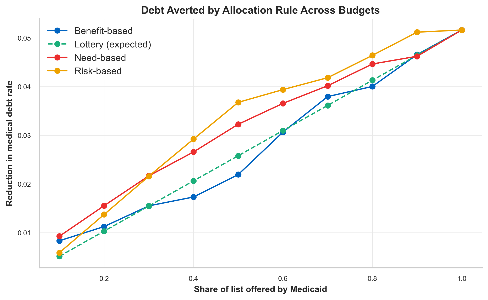
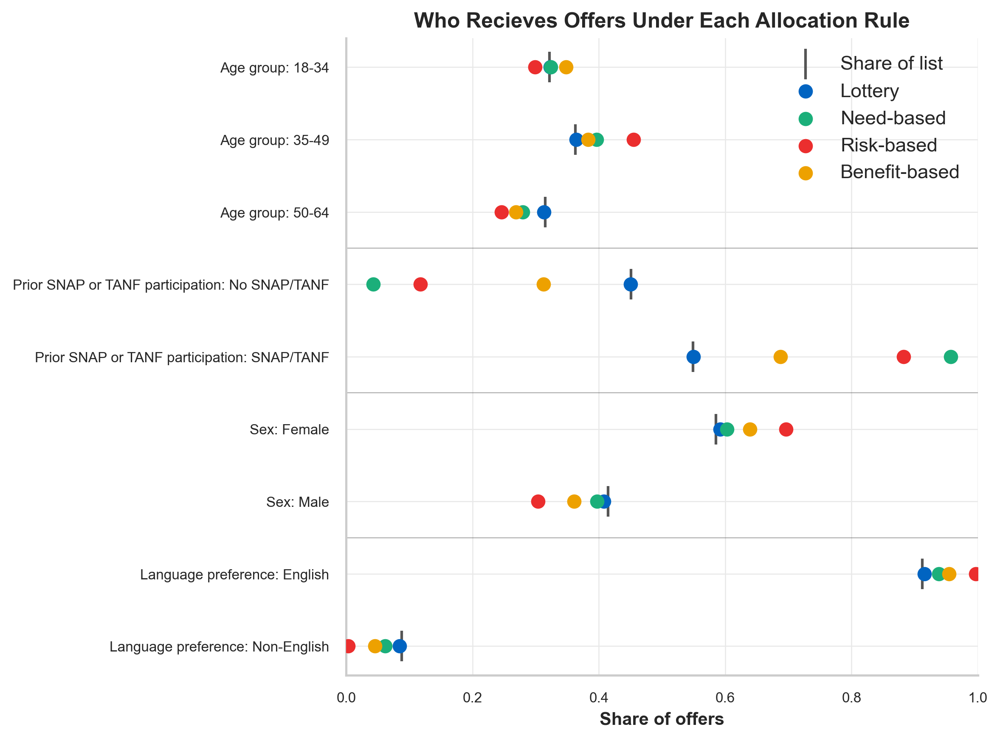
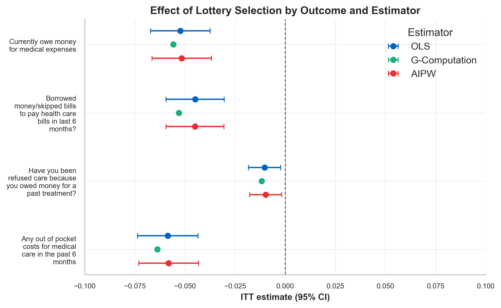
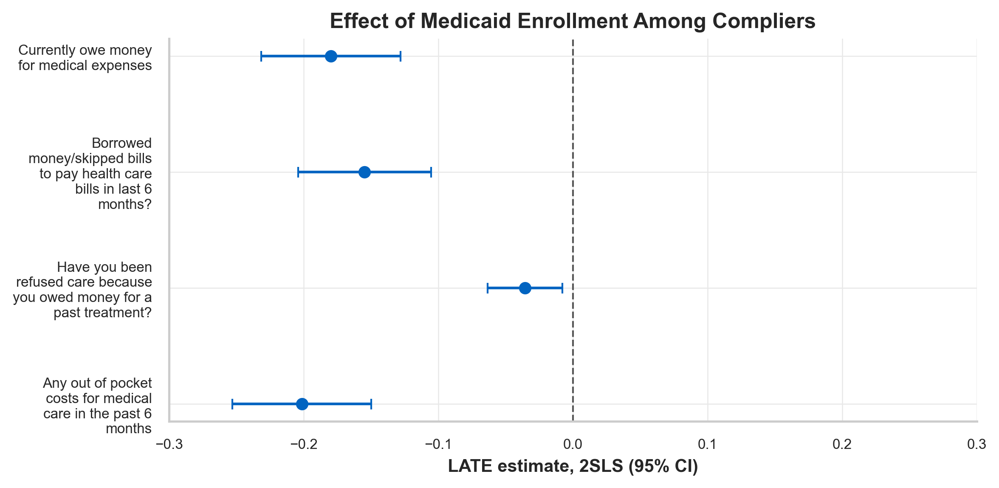
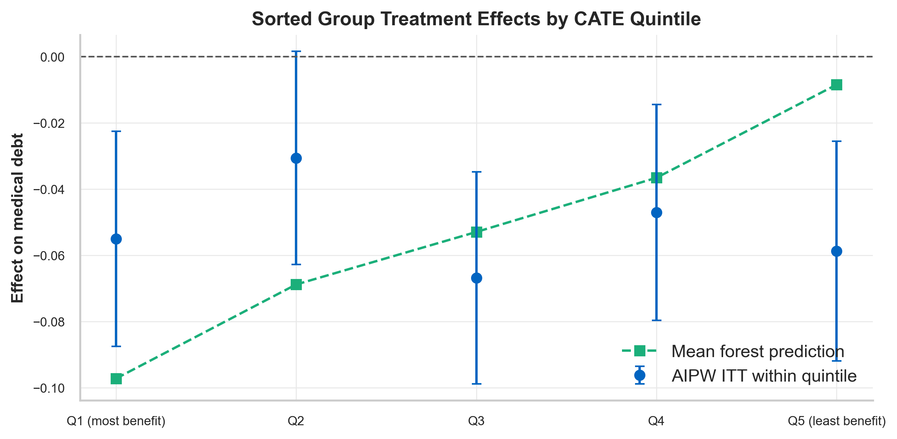
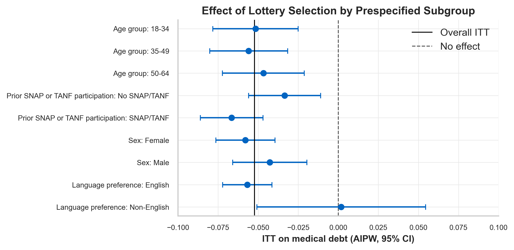
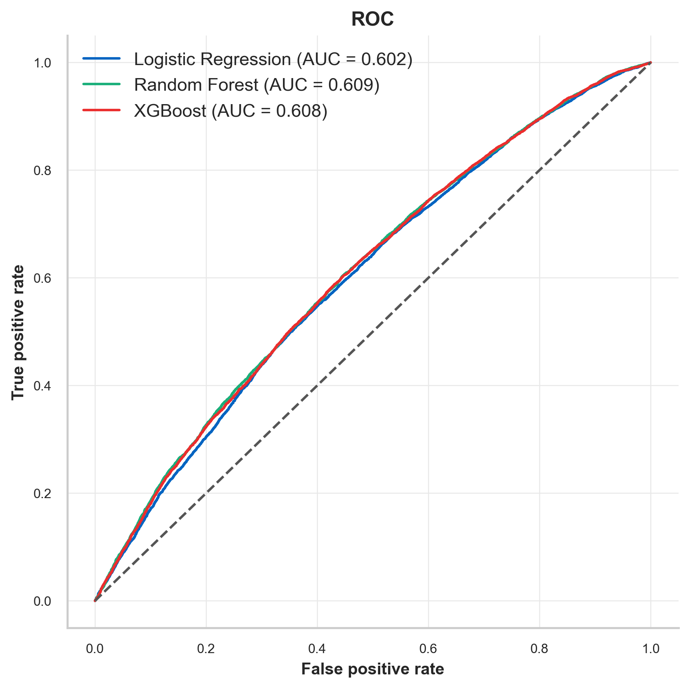
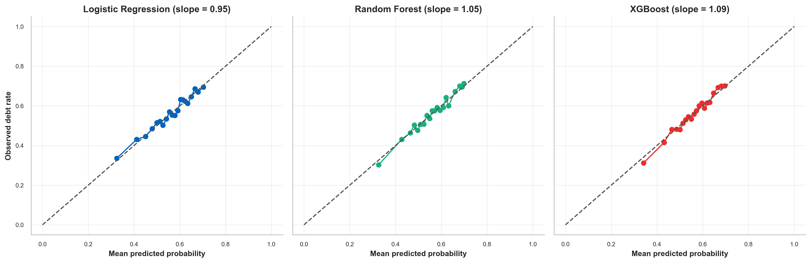
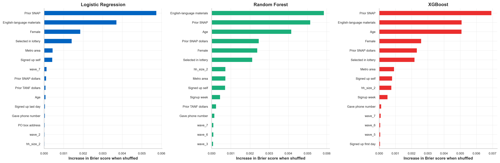

# Allocating Scarce Medicaid Offers

**Lottery, Need-Based, and Learned Targeting in the Oregon Health Insurance Experiment**

Chayce Reed · October 2026

In 2008, Oregon used a lottery to decide which low-income adults could apply for Medicaid. This project asks a question the lottery did not: if a program can only offer coverage to half of its waiting list, who should receive the offer? Using the Oregon Health Insurance Experiment (OHIE) public-use data, the notebook replicates the lottery's effect on medical debt with four estimators, tests whether that effect differs across people with a cross-fitted causal forest, and compares five allocation rules (lottery, need-based, risk-based, benefit-based, universal) under a fixed budget using doubly robust evaluation.

## Key Findings

- Winning the lottery reduced the probability of owing money for medical expenses at 12 months by 5.2 percentage points (SE 0.8), from 59.7% to 53.8%, matching the published OHIE estimate. Weighted OLS, g-computation, and AIPW agree within 0.1 percentage point. Among compliers, enrollment itself reduced medical debt by 18.0 points; only 29% of winners enrolled.
- Pre-lottery characteristics predict medical debt weakly (AUC about 0.60 for all three classifiers), because the sign-up form records little about health, income, or prior medical use.
- The causal forest found no reliable heterogeneity. The calibration test could not distinguish its predicted spread from noise (coefficient 0.01, p = 0.98), and effects within predicted-effect quintiles showed no ordering.
- At the lottery's 50% budget, risk-based targeting averted 3.7 percentage points of medical debt, need-based 3.2, the lottery 2.6, and benefit-based 2.2, against a ceiling of 5.2 if everyone were offered. The risk-based gain over the lottery (1.1 points, 95% CI 0.4 to 1.8) was significant; the need-based gain (0.6, 95% CI -0.1 to 1.4) was borderline but held at every budget from 10% to 80%. Benefit-based targeting was never distinguishable from the lottery.
- Targeting changed who was served. Need-based allocation sent 96% of offers to prior SNAP/TANF participants (55% of the list). Risk-based allocation sent 70% of offers to women and 0.3% to non-English speakers, who make up 8.8% of the list. The rule that averted the most debt did so partly by excluding one group almost entirely.

## Visual Summary

### Policy Simulation

| Debt averted across budgets | Who receives offers under each allocation rule |
|:---:|:---:|
|  |  |

### Causal Inference

| Effect of a lottery offer by outcome and estimator | Effect of enrollment among compliers (2SLS) |
|:---:|:---:|
|  |  |

### Heterogeneity

| Forest prediction vs actual effect by quintile | Effect by prespecified subgroup |
|:---:|:---:|
|  |  |

### Supervised Learning

| ROC curves | Calibration curves | Permutation importance |
|:---:|:---:|:---:|
|  |  |  |

## Data

**Source:** Oregon Health Insurance Experiment Public Use Data, released by the National Bureau of Economic Research. Available at https://www.nber.org/research/data/oregon-health-insurance-experiment-data (free registration).

**Files used:** `oregonhie_descriptive_vars.dta` (lottery list), `oregonhie_stateprograms_vars.dta` (state program records), and `oregonhie_survey12m_vars.dta` (12-month mail survey), merged on person ID.

**Sample:** 23,741 respondents to the 12-month survey, out of 74,922 people on the lottery list.

**Outcome:** Whether the respondent currently owes money for medical expenses at 12 months. Three secondary outcomes capture related financial strain: borrowing money or skipping bills to pay medical bills, being refused care because of past debt, and any out-of-pocket medical spending.

**Predictors:** Fifteen characteristics recorded before the lottery: age, sex, English-language preference, self versus household sign-up, phone number provided, PO box address, metropolitan ZIP code, sign-up week, first- and last-day sign-up, and prior SNAP and TANF participation and household benefit amounts.

**Design features:** Households with more members had more lottery entries, and the survey was mailed in waves tied to the lottery drawings, so the chance of winning varied from 35% to 92% across household-size by wave cells. All causal models condition on those cells, the within-cell offer rate serves as the known propensity score, survey weights are applied throughout so estimates reflect the full lottery list, and standard errors are clustered by household.

## Methods

**Causal inference.** The intention-to-treat effect of a lottery offer is estimated by weighted least squares with household-size by wave fixed effects, following Finkelstein et al. (2012), and checked against the published estimate. The effect of enrollment among compliers is estimated by two-stage least squares with the lottery as the instrument. The ITT is then re-estimated by g-computation (XGBoost outcome models fit per arm, cross-fitted on household-grouped folds) and by augmented inverse probability weighting, which combines those outcome models with the design propensity score and is consistent if either is correct.

**Risk prediction.** Logistic regression, random forest, and XGBoost predict medical debt from the pre-lottery predictors. Models are evaluated on out-of-fold predictions from household-grouped cross-validation, so no respondent is scored by a model that saw their household. Hyperparameters were selected by random search scored on Brier score and are fixed in the notebook; the search can be rerun with `RUN_TUNING = True`. The classification threshold prioritizes sensitivity. Variable importance is assessed by standardized coefficients, permutation importance, and SHAP.

**Heterogeneity.** A causal forest, cross-fitted on the same household folds with honest trees, estimates a conditional average treatment effect for each respondent. Its predictions are tested against the AIPW scores with a calibration regression and sorted group treatment effects (Chernozhukov et al., 2018), and compared with prespecified subgroups by age group, sex, language preference, and prior SNAP/TANF participation.

**Policy simulation.** The budget is fixed at the share of the list the actual lottery offered (11,747 offers). Five rules are compared: lottery (random), need-based (ranked by prior SNAP/TANF benefit dollars), risk-based (ranked by the XGBoost predicted probability of medical debt without coverage), benefit-based (ranked by the causal forest's predicted effect), and universal (everyone offered). Each rule's value is the medical debt it would avert, estimated from the per-person AIPW scores under the rule's assignment and cross-checked with g-computation. Uncertainty comes from a household bootstrap, the comparison is repeated across budgets from 10% to 90%, and the subgroup composition of each rule's offers is compared against the list.

## Notebook Structure

1. **Setup**: package version check, imports and seed, file paths and data location, plot theme
2. **Data Loading & Merging**: reading the Stata files, subsetting and merging, renaming and labeling, derived variables, variable roles
3. **Data Structure & Inspection**
4. **Data Checks & Cleaning**: ID uniqueness, data types, validity rules, missingness; one respondent dropped, outcomes analyzed on respondents who answered
5. **Data Exploration & Visualization**: descriptive statistics, treatment group comparisons, distributions, outcomes by lottery status and subgroup, Spearman correlation heatmap
6. **Supervised Machine Learning Classification**: design matrix and household-grouped folds, logistic regression, random forest, XGBoost, out-of-fold predictions, threshold selection, performance metrics and overfit check, ROC and calibration curves, confusion matrices, variable importance
7. **Causal Inference**: design propensity score, covariate balance, ITT (OLS), LATE (2SLS), g-computation, AIPW, summary of estimates
8. **Heterogeneity**: causal forest, CATE distribution, calibration test and GATES, prespecified subgroups, forest feature importance
9. **Policy Simulation**: fixed budget, allocation rules, doubly robust evaluation, g-computation cross-check, household bootstrap, budget sweep, subgroup composition of offers
10. **Summary**: results, assumptions, limitations, conclusions

## Repository Structure

```
ohie-medicaid-policy-simulation/
├── README.md
├── LICENSE
├── requirements.txt
├── ohie_medicaid_policy_simulation.ipynb
└── outputs/               # figures written by the notebook
```

## How To Run

1. Create an environment with the pinned package versions: `pip install -r requirements.txt` (Python 3.13).
2. Download `oregon_puf.zip` from the NBER page linked above and place it in `data/raw/`. The notebook unzips it and locates the `.dta` files automatically.
3. Run the notebook top to bottom. Figures are written to `outputs/`.

## Limitations

The comparison is conditional on the information a program has at sign-up; richer data on health, income, or prior medical use would likely improve the risk score and might reveal heterogeneity the forest could not find. The simulation allocates offers, not coverage: only 29% of winners enrolled, so a rule's realized value depends on who takes up the offer as well as who receives it, and take-up was not modeled. The gains from targeting are small in absolute terms. The data come from one state in 2008, before the ACA Medicaid expansion, and describe low-income uninsured adults who chose to sign up for the lottery.

## Acknowledgements & Citations

- Finkelstein, A. (2013). *Oregon Health Insurance Experiment Public Use Data*. National Bureau of Economic Research. https://www.nber.org/research/data/oregon-health-insurance-experiment-data
- Finkelstein, A., Taubman, S., Wright, B., Bernstein, M., Gruber, J., Newhouse, J. P., Allen, H., Baicker, K., & Oregon Health Study Group. (2012). The Oregon Health Insurance Experiment: Evidence from the first year. *Quarterly Journal of Economics*, 127(3), 1057–1106. https://doi.org/10.1093/qje/qjs020

## AI Use Statement

Generative AI (Claude) was used as a coding, learning, and editing assistant: for Python syntax and package questions (reading Stata files with pyreadstat, household-grouped cross-validation with GroupKFold, 2SLS with linearmodels, causal forests with EconML); for implementing and understanding the classification, causal inference, and heterogeneity methods and their mathematical notation; and for editing notebook and README structure and text. All analysis decisions, code, and interpretations were reviewed and verified by the author.

## License

Code and text in this repository are released under the [MIT License](LICENSE). The OHIE data are not included and remain subject to the NBER terms of use described in [`data/README.md`](data/README.md).
